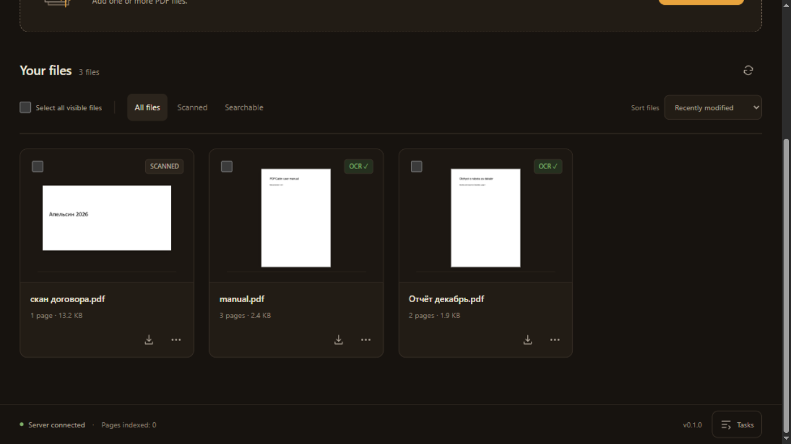
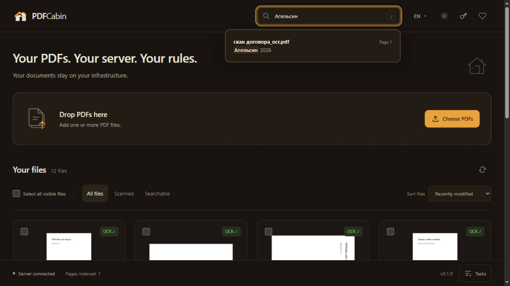
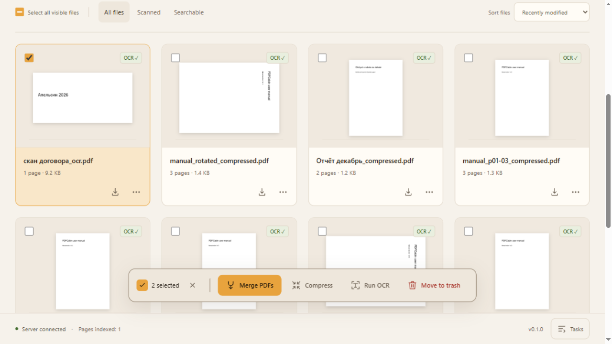
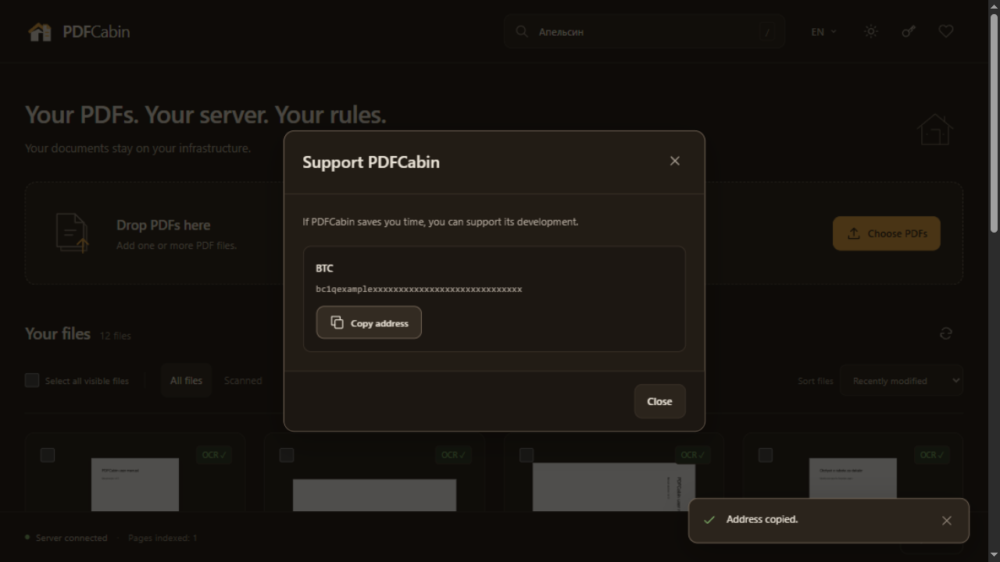
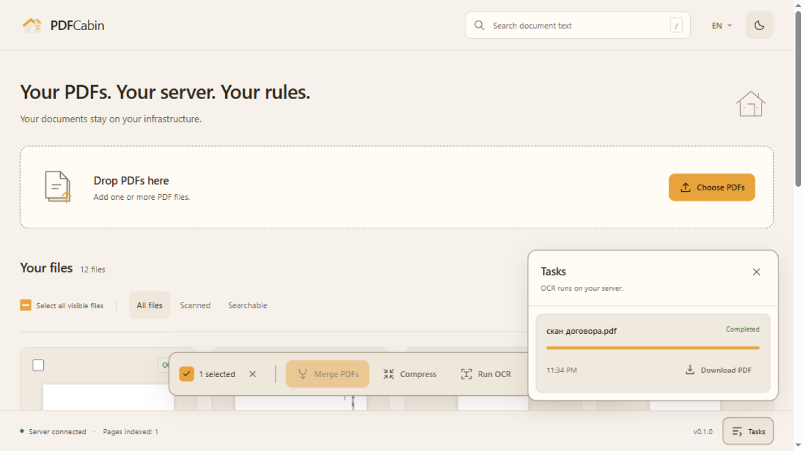
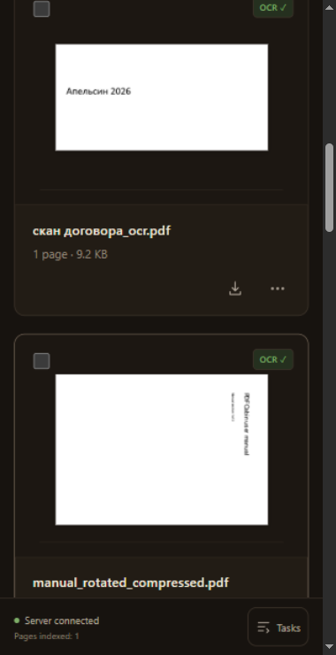

# PDFCabin — Self-Hosted PDF Toolkit & MCP Server

> **Your PDFs. Your server. Your rules.**
> Your documents stay on your infrastructure.

English · [Русский](README.ru.md)

[](https://github.com/LegitAntiAA/pdfcabin/actions/workflows/ci.yml)
[](https://github.com/LegitAntiAA/pdfcabin/pkgs/container/pdfcabin)
[](LICENSE)
[](https://github.com/LegitAntiAA/pdfcabin/pulls)

A local document workshop: merge, split, rotate and compress PDFs, run OCR (Russian + English) on your scans, then full-text search across everything — through a web UI or directly from Claude or any other MCP-capable AI agent. One Docker container, one port (**8420**), zero outbound requests, no telemetry.

## Why PDFCabin?

- **Nothing leaves your machine.** All processing runs locally in a single container. No cloud calls, no analytics, no telemetry — even the web UI ships without a single external URL (no CDN, system fonts only).
- **Russian + English OCR out of the box.** Built on Tesseract and OCRmyPDF: scanned PDFs get a searchable text layer, and everything recognized becomes full-text searchable.
- **Your AI agents get tools.** A built-in MCP server (streamable HTTP) exposes 15 focused tools — Claude, or any MCP client, can import, create, merge, compress, OCR, read, rename and search your documents without a single file leaving your server.

## Quick start

```bash
docker run -d -p 8420:8420 -v ./docs:/docs ghcr.io/legitantiaa/pdfcabin:latest
```

Open `http://localhost:8420` and drop some PDFs. Everything the app writes — your files and the search index `index.db` — stays in the `./docs` folder you mounted.

To protect the instance with a token:

```bash
docker run -d -p 8420:8420 -v ./docs:/docs -e PDFCABIN_TOKEN=change-me ghcr.io/legitantiaa/pdfcabin:latest
```

Or build from source:

```bash
git clone https://github.com/LegitAntiAA/pdfcabin.git
cd pdfcabin
docker compose up --build
```

> **Security note:** inside Docker the app listens on `0.0.0.0:8420`. Don't expose it bare to the internet — set `PDFCABIN_TOKEN` and put it behind a reverse proxy.

## Features

The bundled web UI (vanilla JS, no build step, no CDN) gives you a drag-and-drop upload zone, a thumbnail grid with OCR status badges, batch actions (merge / compress / OCR / delete), a jobs drawer and a search bar — dark and light themes, English and Russian interface.

### REST API

| Method | Endpoint | Description |
|---|---|---|
| `GET` | `/api/health` | Status, version, available OCR languages, Ghostscript presence |
| `GET` | `/api/files` | List documents (`?subdir=`), with page counts and text-layer flag |
| `POST` | `/api/upload` | Upload PDFs — validated by `%PDF-` magic bytes, filenames sanitized |
| `GET` | `/api/file/info?path=` | Metadata: pages, size, encrypted, title, author |
| `GET` | `/api/file/thumb?path=&page=1` | PNG page thumbnail |
| `GET` | `/api/download?path=` | Download the original file |
| `DELETE` | `/api/file?path=` | Delete a file — moves it to `trash/` inside the docs folder and removes it from the search index |
| `POST` | `/api/merge` | Merge PDFs in the given order |
| `POST` | `/api/split` | Split by page ranges (`"1-3,5"`) or every N pages |
| `POST` | `/api/rotate` | Rotate pages by 90 / 180 / 270 degrees |
| `POST` | `/api/delete-pages` | Delete pages |
| `POST` | `/api/compress` | `fast` — lossless (pikepdf); `strong` — Ghostscript image downsampling, meant for scans |
| `POST` | `/api/extract-text` | Extract text page by page |
| `POST` | `/api/ocr` | Queue OCR (`rus+eng` by default) — returns `202` and a job id; the result is a searchable PDF, auto-indexed |
| `GET` | `/api/jobs/{id}` · `/api/jobs` | Job status; the list returns active jobs first, then finished ones |
| `GET` | `/api/search?q=&limit=` | Full-text search over indexed pages, with snippets |
| `GET` | `/api/stats` | Number of indexed files and pages |
| `GET` | `/api/donate` | Donation addresses configured via env (usually empty) |

Honest note on search: it matches **exact word forms** (SQLite FTS5, `unicode61` tokenizer) — no stemming. Searching Russian «договор» will not match «договора».

### MCP tools

| Tool | Description |
|---|---|
| `list_documents()` | What's in the library, with page counts |
| `pdf_info(path)` | Pages, size, encrypted, has text layer |
| `upload_document(source_path, name=None, overwrite=False)` | Import a PDF from a local path on this machine into the library |
| `create_document(text, name="document.pdf", overwrite=False)` | Make a new PDF from plain text (unicode-safe) |
| `save_document(path, target_path, overwrite=False)` | Save a library PDF to any local path on this machine |
| `delete_document(path)` | Move a PDF to the library trash (same as UI Delete) |
| `rename_document(path, new_name, overwrite=False)` | Rename a PDF; the search index follows automatically |
| `pdf_merge(paths, output)` | Merge PDFs in the given order |
| `pdf_split(path, mode, value)` | Split by ranges or every N pages |
| `pdf_rotate(path, pages, angle, output, overwrite=False)` | Rotate pages 90/180/270 into a new file |
| `pdf_delete_pages(path, pages, output, overwrite=False)` | Drop pages into a new file |
| `pdf_compress(path, output, level="fast")` | Compress; reports the savings in percent |
| `pdf_ocr(path, languages="rus+eng", force=False)` | OCR — blocks until the background queue finishes, then indexes the result |
| `extract_text(path, pages=None)` | "Read me this PDF" |
| `search_documents(query, limit=20)` | Full-text search with snippets (path + page) |

Paths in MCP tools are relative to the documents folder — the agent never needs to know your mounts. The MCP endpoint is served by the same app and port as the UI and the REST API, and `PDFCABIN_TOKEN` (when set) applies to it too.

## MCP connection

MCP transport: **streamable HTTP**, URL `http://localhost:8420/mcp`.

### Claude Desktop

`claude_desktop_config.json` (Settings → Developer → Edit Config):

```json
{
  "mcpServers": {
    "pdfcabin": {
      "url": "http://localhost:8420/mcp"
    }
  }
}
```

### Claude Code

```bash
claude mcp add --transport http pdfcabin http://localhost:8420/mcp
```

### Cursor

`~/.cursor/mcp.json`:

```json
{
  "mcpServers": {
    "pdfcabin": {
      "url": "http://localhost:8420/mcp"
    }
  }
}
```

### With a token

If `PDFCABIN_TOKEN` is set, add an `Authorization: Bearer` header:

```json
{
  "mcpServers": {
    "pdfcabin": {
      "url": "http://localhost:8420/mcp",
      "headers": {
        "Authorization": "Bearer YOUR_TOKEN"
      }
    }
  }
}
```

```bash
claude mcp add --transport http pdfcabin http://localhost:8420/mcp --header "Authorization: Bearer YOUR_TOKEN"
```

Any other MCP client speaks the same JSON shape — point it at `http://localhost:8420/mcp`.

## Configuration

| Variable | Default | Description |
|---|---|---|
| `PDFCABIN_DOCS_DIR` | `./docs` (`/docs` in the container) | Root folder for all PDFs and the search index (`index.db`) |
| `PDFCABIN_TOKEN` | empty — no auth | Bearer token for `/api` and `/mcp`; if set, it is required |
| `PDFCABIN_HOST` | `127.0.0.1` | docker compose sets `0.0.0.0` |
| `PDFCABIN_PORT` | `8420` | HTTP port |
| `PDFCABIN_LANGS` | `rus,eng` | Available OCR languages (must match the installed tesseract language data) |
| `PDFCABIN_MAX_UPLOAD_MB` | `200` | Upload size limit |

## Screenshots













## Development

Run locally without Docker:

- Python **3.11+**
- System packages: Tesseract OCR with the `rus` and `eng` language data, and Ghostscript (used for `strong` compression)

```bash
pip install -e ".[dev]"
uvicorn app.main:app --port 8420
```

Files live in `./docs` by default (override with `PDFCABIN_DOCS_DIR`).

```bash
pytest                # full suite; OCR tests are marked `slow` and need tesseract with the configured languages
pytest -m "not slow"  # skip the OCR tests
ruff check .          # lint
```

## Roadmap

- **v0.1 (this scope):** merge / split / rotate / delete pages / compress / OCR (rus+eng) / full-text search / 15 MCP tools / web UI / Docker.
- **v0.2:** watermark, password protect/unlock, DOCX→PDF (optional, as a separate image), drag-and-drop page reordering in the UI, a redo-OCR button, more OCR languages.
- **v0.3:** watch-folder (auto-OCR of new files), webhooks, read-only REST keys, export to Paperless-ngx.
- **v1.0:** search with stemming (Russian), PWA.

## Donate

PDFCabin is free and will stay free. If it saves you time, you can support the project:

| Network | Address |
|---|---|
| BTC | `bc1qw4my95y7uhmg7up7w762qfju04l6960plpkp0u` |
| Ethereum (ETH) | `0x9a3e38ffa8d0002e8423a101b98ef214a574abde` |
| USDT (ERC-20) | `0x9a3e38ffa8d0002e8423a101b98ef214a574abde` |
| USDT (TRC-20) | `TNGrTqLZZdf99zTQoSABvXmAzPTh7NfESk` |
| TON | `UQBwZJojKzuIFCpf4V_RSVCSub4J96IWulnfeJ-hYRviB3nw` |

## License

[MIT](LICENSE).

Built on Tesseract OCR, OCRmyPDF, pikepdf, FastMCP and Ghostscript. Ghostscript is AGPL-licensed and invoked by PDFCabin as a separate process.
