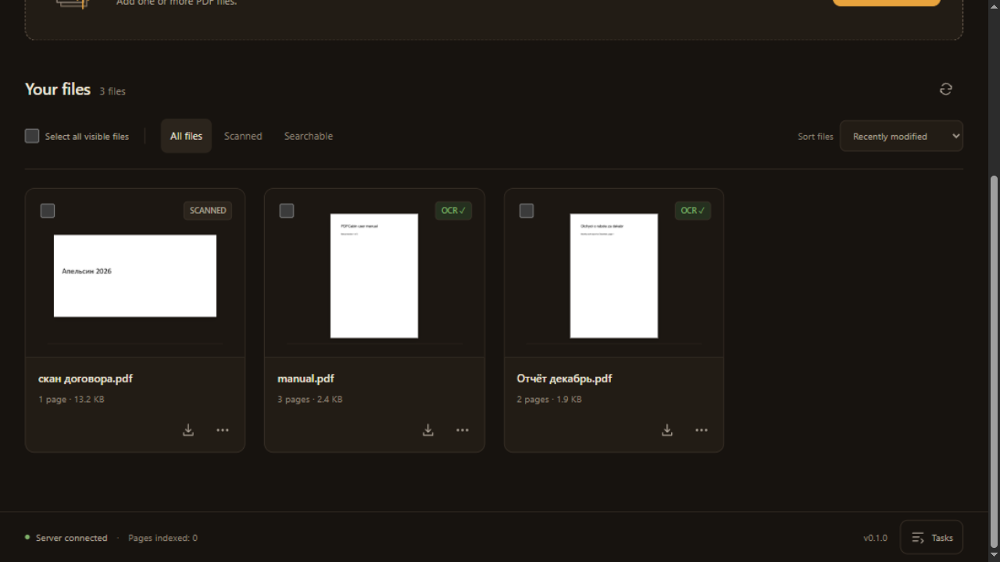
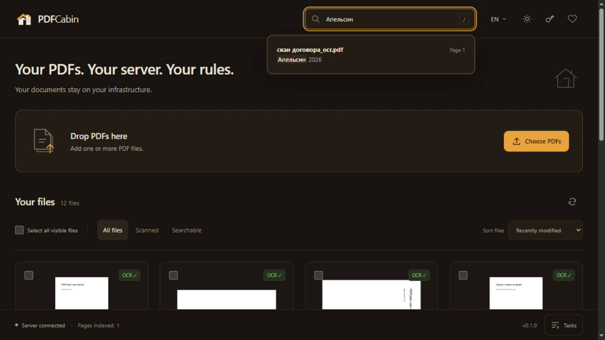
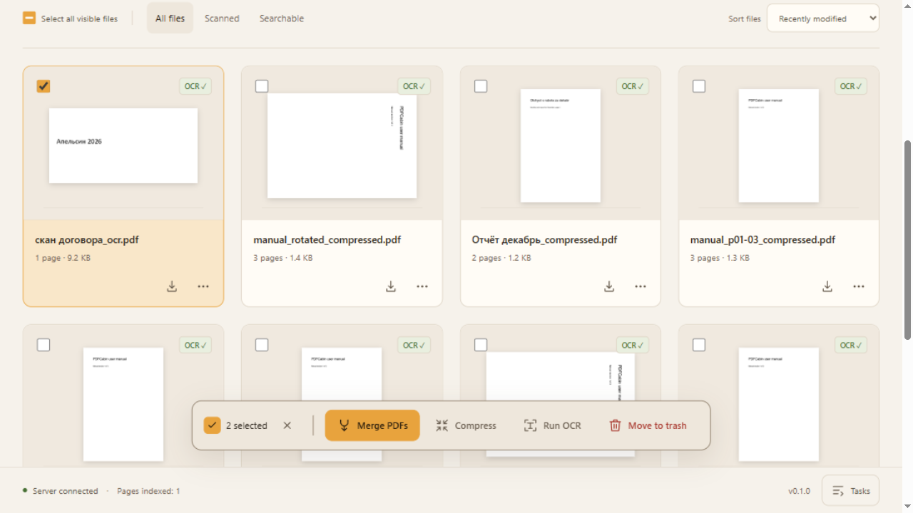
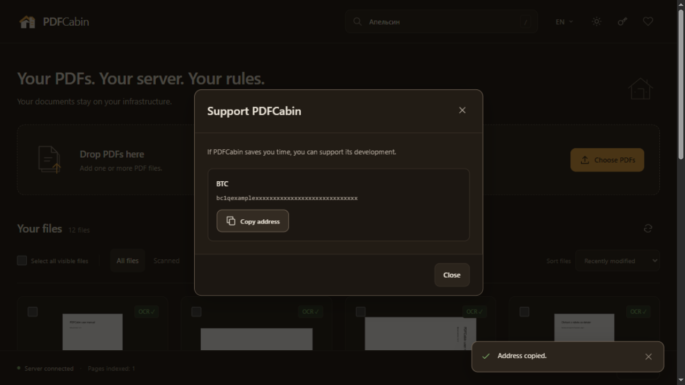
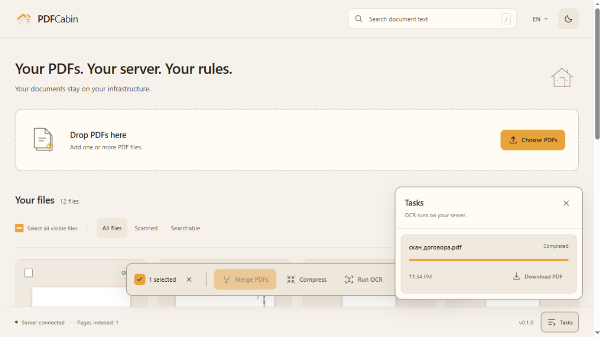
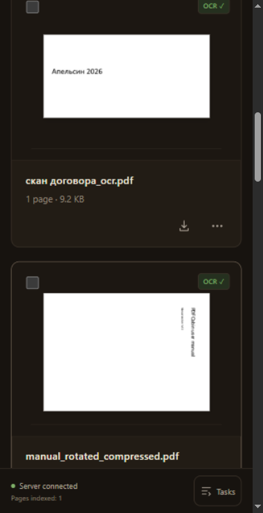

# PDFCabin — Self-Hosted PDF Toolkit & MCP Server

> **Your PDFs. Your server. Your rules.**
> Your documents stay on your infrastructure.

[English](README.md) · Русский

[](https://github.com/OWNER/pdfcabin/actions/workflows/ci.yml)
[](https://github.com/OWNER/pdfcabin/pkgs/container/pdfcabin)
[](LICENSE)
[](https://github.com/OWNER/pdfcabin/pulls)

Локальная «мастерская документов»: склейка, разбивка, поворот и сжатие PDF, OCR (русский + английский) для сканов и полнотекстовый поиск по всему этому — через веб-интерфейс или напрямую из Claude и любого другого AI-агента с поддержкой MCP. Один Docker-контейнер, один порт (**8420**), ноль исходящих запросов, никакой телеметрии.

## Почему PDFCabin?

- **Ничего не покидает вашу машину.** Вся обработка — локально, в одном контейнере. Никаких облачных вызовов, аналитики и телеметрии; даже веб-интерфейс не содержит ни одного внешнего URL (никаких CDN, только системные шрифты).
- **OCR русский + английский из коробки.** На базе Tesseract и OCRmyPDF: сканы получают текстовый слой (searchable PDF), а всё распознанное становится доступно полнотекстовому поиску.
- **Ваши AI-агенты получают инструменты.** Встроенный MCP-сервер (streamable HTTP) отдаёт 15 компактных тулов: Claude — или любой MCP-клиент — может загружать, создавать, склеивать, сжимать, распознавать, читать, переименовывать и искать ваши документы, не отправляя ни один файл наружу.

## Быстрый старт

```bash
docker run -d -p 8420:8420 -v ./docs:/docs ghcr.io/OWNER/pdfcabin:latest
```

Откройте `http://localhost:8420` и перетащите PDF-файлы. Всё, что пишет приложение, — ваши файлы и поисковый индекс `index.db` — остаётся в примонтированной папке `./docs`.

Чтобы защитить инстанс токеном:

```bash
docker run -d -p 8420:8420 -v ./docs:/docs -e PDFCABIN_TOKEN=change-me ghcr.io/OWNER/pdfcabin:latest
```

Или соберите из исходников:

```bash
git clone https://github.com/OWNER/pdfcabin.git
cd pdfcabin
docker compose up --build
```

> **Замечание о безопасности:** внутри Docker приложение слушает `0.0.0.0:8420`. Не выставляйте его голым в интернет — задайте `PDFCABIN_TOKEN` и поставьте обратный прокси.

## Возможности

Встроенный веб-интерфейс (ванильный JS, без сборки и без CDN): дропзона для загрузки, сетка карточек с превью и бейджами OCR-статуса, пакетные действия (merge / compress / OCR / delete), панель задач и строка поиска; тёмная и светлая темы, интерфейс на русском и английском.

### REST API

| Метод | Путь | Описание |
|---|---|---|
| `GET` | `/api/health` | Статус, версия, доступные OCR-языки, наличие Ghostscript |
| `GET` | `/api/files` | Список документов (`?subdir=`), с числом страниц и признаком текстового слоя |
| `POST` | `/api/upload` | Загрузка PDF — проверка по магическим байтам `%PDF-`, имена файлов санитизируются |
| `GET` | `/api/file/info?path=` | Метаданные: страницы, размер, шифрование, название, автор |
| `GET` | `/api/file/thumb?path=&page=1` | PNG-превью страницы |
| `GET` | `/api/download?path=` | Скачивание исходного файла |
| `DELETE` | `/api/file?path=` | Удаление файла — перемещает его в `trash/` внутри папки документов и убирает из поискового индекса |
| `POST` | `/api/merge` | Склейка PDF в заданном порядке |
| `POST` | `/api/split` | Разбивка по диапазонам страниц (`"1-3,5"`) или по N страниц |
| `POST` | `/api/rotate` | Поворот страниц на 90 / 180 / 270 градусов |
| `POST` | `/api/delete-pages` | Удаление страниц из документа |
| `POST` | `/api/compress` | `fast` — сжатие без потерь (pikepdf); `strong` — даунсемплинг изображений через Ghostscript, для сканов |
| `POST` | `/api/extract-text` | Извлечение текста постранично |
| `POST` | `/api/ocr` | Постановка OCR в очередь (`rus+eng` по умолчанию) — возвращает `202` и id задачи; результат — searchable PDF, сразу попадает в индекс |
| `GET` | `/api/jobs/{id}` · `/api/jobs` | Статус задачи; список — сначала активные, затем завершённые |
| `GET` | `/api/search?q=&limit=` | Полнотекстовый поиск по проиндексированным страницам, со сниппетами |
| `GET` | `/api/stats` | Число проиндексированных файлов и страниц |
| `GET` | `/api/donate` | Донат-адреса из переменных окружения (обычно пусто) |

Честное замечание про поиск: он находит **точные словоформы** (SQLite FTS5, токенизатор `unicode61`) — без стемминга. Поиск по «договор» не найдёт «договора».

### MCP-тулы

| Тул | Описание |
|---|---|
| `list_documents()` | Что лежит в библиотеке, с числом страниц |
| `pdf_info(path)` | Страницы, размер, шифрование, наличие текстового слоя |
| `upload_document(source_path, name=None, overwrite=False)` | Загрузить PDF с локального пути этой машины в библиотеку |
| `create_document(text, name="document.pdf", overwrite=False)` | Создать новый PDF из текста (юникод-безопасно) |
| `save_document(path, target_path, overwrite=False)` | Сохранить PDF из библиотеки на любой локальный путь |
| `delete_document(path)` | Переместить PDF в trash библиотеки (как «Удалить» в UI) |
| `rename_document(path, new_name, overwrite=False)` | Переименовать PDF; поисковый индекс обновится сам |
| `pdf_merge(paths, output)` | Склейка PDF в заданном порядке |
| `pdf_split(path, mode, value)` | Разбивка по диапазонам или по N страниц |
| `pdf_rotate(path, pages, angle, output, overwrite=False)` | Повернуть страницы на 90/180/270 в новый файл |
| `pdf_delete_pages(path, pages, output, overwrite=False)` | Удалить страницы в новый файл |
| `pdf_compress(path, output, level="fast")` | Сжатие; возвращает экономию в процентах |
| `pdf_ocr(path, languages="rus+eng", force=False)` | OCR — блокируется до завершения фоновой очереди, затем индексирует результат |
| `extract_text(path, pages=None)` | «Прочитай мне этот PDF» |
| `search_documents(query, limit=20)` | Полнотекстовый поиск со сниппетами (путь + страница) |

Пути в MCP-тулах — относительные от папки документов: агенту не нужно знать про ваши монтирования. MCP-эндпоинт обслуживается тем же приложением и портом, что и UI и REST API; `PDFCABIN_TOKEN` (если задан) действует и на него.

## Подключение MCP

Транспорт MCP: **streamable HTTP**, URL `http://localhost:8420/mcp`.

### Claude Desktop

`claude_desktop_config.json` (Settings → Developer → Edit Config):

```json
{
  "mcpServers": {
    "pdfcabin": {
      "url": "http://localhost:8420/mcp"
    }
  }
}
```

### Claude Code

```bash
claude mcp add --transport http pdfcabin http://localhost:8420/mcp
```

### Cursor

`~/.cursor/mcp.json`:

```json
{
  "mcpServers": {
    "pdfcabin": {
      "url": "http://localhost:8420/mcp"
    }
  }
}
```

### С токеном

Если задан `PDFCABIN_TOKEN`, добавьте заголовок `Authorization: Bearer`:

```json
{
  "mcpServers": {
    "pdfcabin": {
      "url": "http://localhost:8420/mcp",
      "headers": {
        "Authorization": "Bearer YOUR_TOKEN"
      }
    }
  }
}
```

```bash
claude mcp add --transport http pdfcabin http://localhost:8420/mcp --header "Authorization: Bearer YOUR_TOKEN"
```

Любой другой MCP-клиент использует ту же JSON-структуру — укажите URL `http://localhost:8420/mcp`.

## Конфигурация

| Переменная | По умолчанию | Описание |
|---|---|---|
| `PDFCABIN_DOCS_DIR` | `./docs` (в контейнере `/docs`) | Корневая папка для всех PDF и поискового индекса (`index.db`) |
| `PDFCABIN_TOKEN` | пусто — без авторизации | Bearer-токен для `/api` и `/mcp`; если задан — обязателен |
| `PDFCABIN_HOST` | `127.0.0.1` | docker compose выставляет `0.0.0.0` |
| `PDFCABIN_PORT` | `8420` | HTTP-порт |
| `PDFCABIN_LANGS` | `rus,eng` | Доступные OCR-языки (должны совпадать с установленными языковыми данными tesseract) |
| `PDFCABIN_MAX_UPLOAD_MB` | `200` | Лимит размера загрузки |
| `PDFCABIN_DONATE_BTC` | адрес автора | BTC-адрес для блока донатов (веб-интерфейс и README) |
| `PDFCABIN_DONATE_ETH` | адрес автора | Ethereum-адрес (принимает ETH и USDT ERC-20) |
| `PDFCABIN_DONATE_TON` | адрес автора | TON-адрес |
| `PDFCABIN_DONATE_USDT_TRC20` | адрес автора | USDT (TRC-20) адрес |

## Скриншоты













<!-- TODO: screenshots/mcp-demo.gif — аплоад → OCR → поиск из Claude через MCP -->

## Разработка

Локальный запуск без Docker:

- Python **3.11+**
- Системные пакеты: Tesseract OCR с языковыми данными `rus` и `eng`, а также Ghostscript (нужен для `strong`-сжатия)

```bash
pip install -e ".[dev]"
uvicorn app.main:app --port 8420
```

Файлы по умолчанию складываются в `./docs` (меняется через `PDFCABIN_DOCS_DIR`).

```bash
pytest                # весь набор; OCR-тесты помечены `slow` и требуют tesseract с настроенными языками
pytest -m "not slow"  # без OCR-тестов
ruff check .          # линтер
```

## Дорожная карта

- **v0.1 (текущий скоуп):** merge / split / rotate / удаление страниц / сжатие / OCR (rus+eng) / полнотекстовый поиск / 15 MCP-тулов / веб-UI / Docker.
- **v0.2:** водяные знаки, защита паролем и снятие защиты, DOCX→PDF (опционально, отдельным образом), перетаскивание страниц в UI, кнопка повторного OCR, больше OCR-языков.
- **v0.3:** watch-folder (авто-OCR новых файлов), вебхуки, read-only REST-ключи, экспорт в Paperless-ngx.
- **v1.0:** поиск со стеммингом (русский), PWA.

## Донаты

PDFCabin бесплатен и останется бесплатным. Если проект экономит вам время, можно поддержать разработку:

| Сеть | Адрес |
|---|---|
| BTC | `bc1qw4my95y7uhmg7up7w762qfju04l6960plpkp0u` |
| Ethereum (ETH) | `0x9a3e38ffa8d0002e8423a101b98ef214a574abde` |
| USDT (ERC-20) | `0x9a3e38ffa8d0002e8423a101b98ef214a574abde` |
| USDT (TRC-20) | `TNGrTqLZZdf99zTQoSABvXmAzPTh7NfESk` |
| TON | `UQBwZJojKzuIFCpf4V_RSVCSub4J96IWulnfeJ-hYRviB3nw` |

Эти адреса также вшиты в само приложение: любой запуск — локальный или Docker — показывает их за кнопкой ♥ в интерфейсе. Делаете форк? Задайте свои адреса через переменные окружения `PDFCABIN_DONATE_*` (или отредактируйте `app/config.py`) — и ваша сборка получит собственный блок донатов (в README и в веб-интерфейсе через `GET /api/donate`).

## Лицензия

[MIT](LICENSE).

Сделано на базе Tesseract OCR, OCRmyPDF, pikepdf, FastMCP и Ghostscript. Ghostscript распространяется по лицензии AGPL и вызывается PDFCabin как отдельный процесс.
